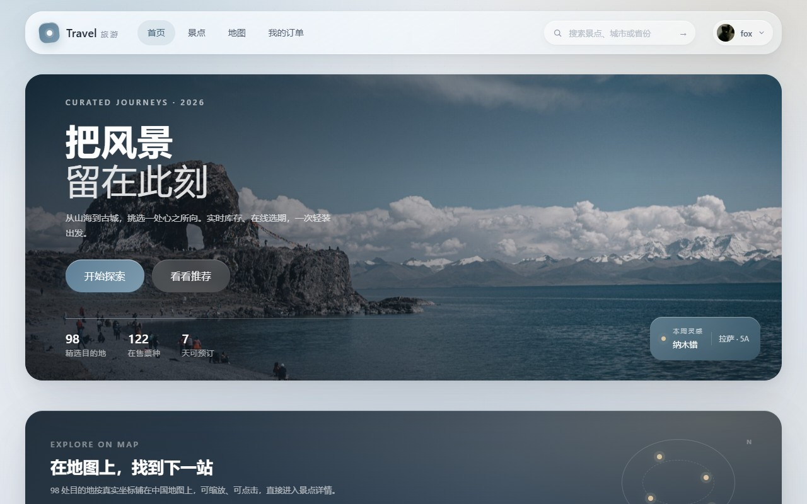
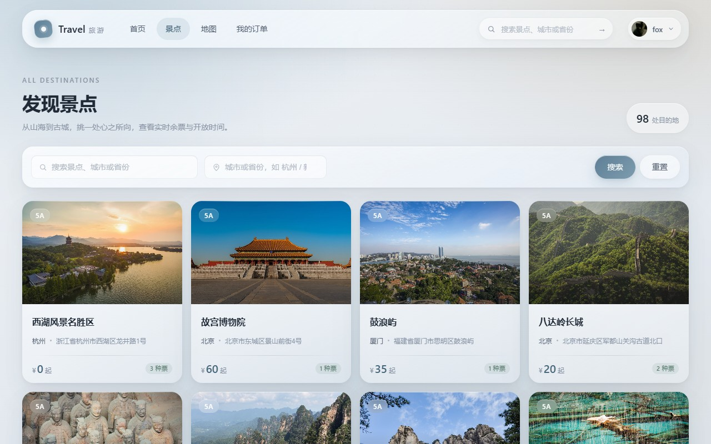
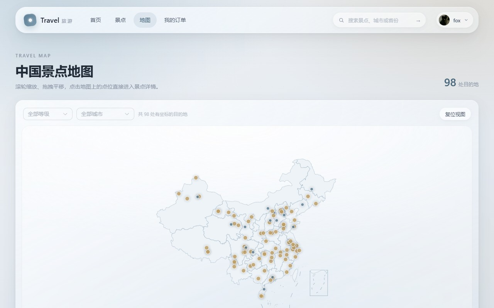
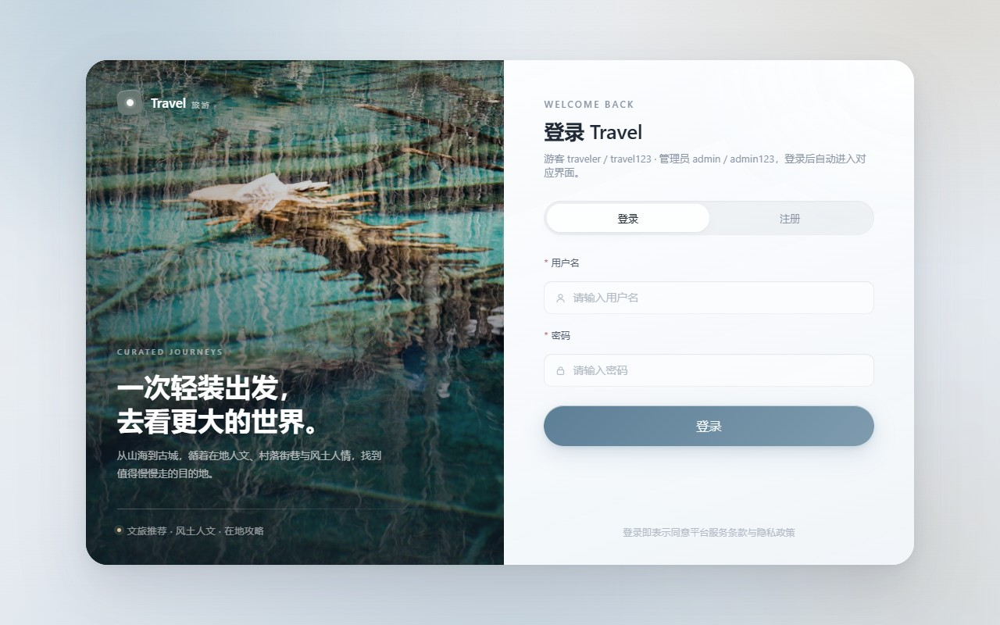
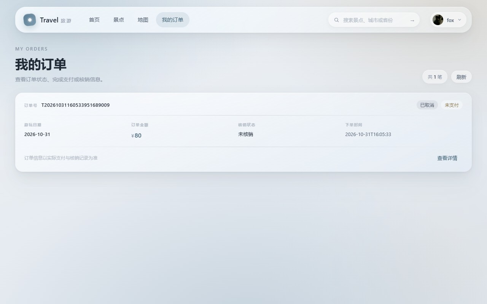
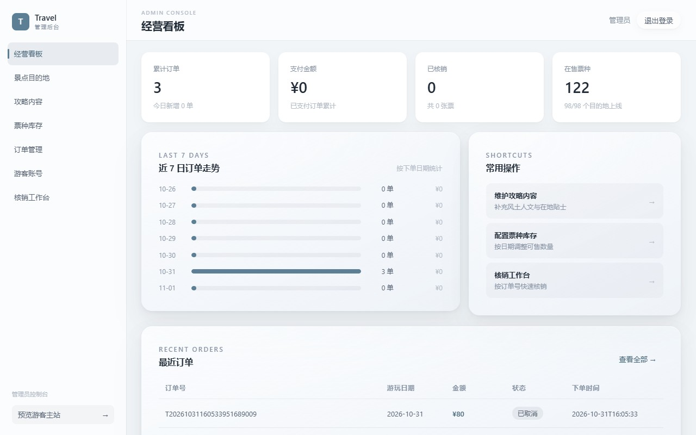
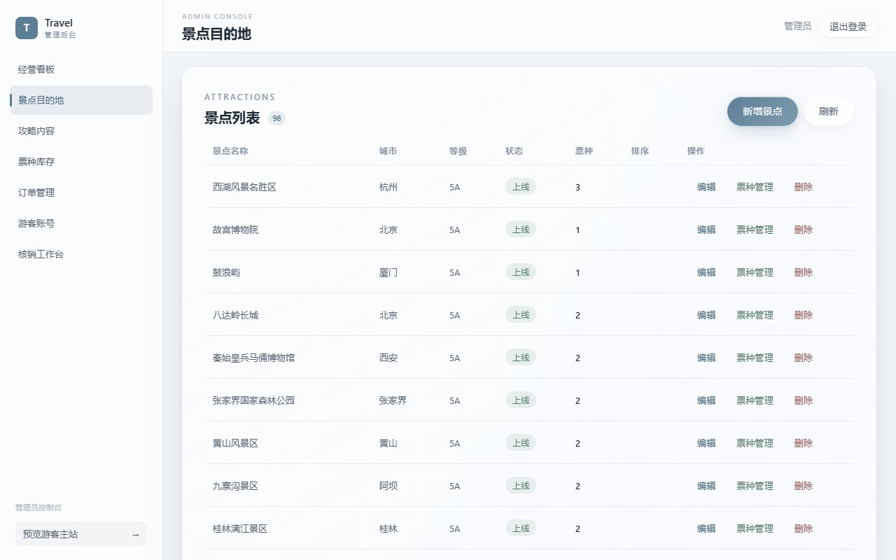
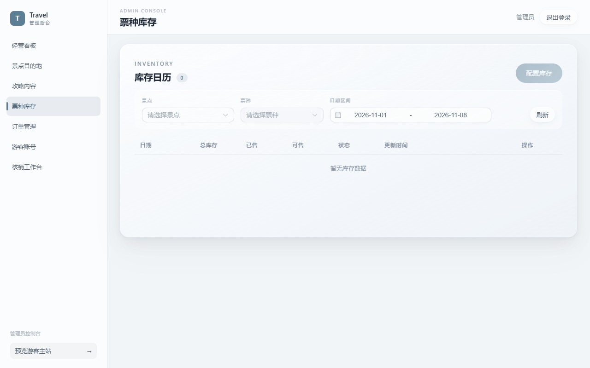

# 文旅预订平台

一个面向文旅场景的全栈预订系统：游客可以浏览景点、查看攻略与地图分布、按日期购买门票、收藏心仪目的地并在线支付；管理员通过独立的 `/admin` 后台维护景点内容、票种与库存、订单和游客账号，并完成现场核销。

前后端分离，前端为单页应用，C 端与 `/admin` 管理端共用一套构建产物、通过路由区分。

## 界面预览

### 游客端

| 首页 | 景点列表 |
| --- | --- |
|  |  |

| 景点详情 | 中国景点地图 |
| --- | --- |
|  |  |

| 登录 | 我的订单 |
| --- | --- |
|  |  |

### 管理端（`/admin`）

| 经营看板 | 景点目的地 | 票种库存 |
| --- | --- | --- |
|  |  |  |

## 功能特性

### 游客端

- **景点浏览**：关键词 / 城市筛选、景点详情（文化介绍、游玩路线、本地贴士）
- **地图分布**：基于 ECharts + 中国地图 JSON 的景点分布可视化
- **门票预订**：按票种与出行日期查询库存日历，下单并锁定库存
- **在线支付**：模拟支付渠道，支付回调后自动更新订单与支付状态
- **订单管理**：订单列表、详情、取消未支付订单
- **收藏与推荐**：收藏景点；基于城市偏好 + 景区等级 + 运营排序的规则推荐
- **个人中心**：修改昵称、头像上传、修改登录名与密码

### 管理端（`/admin`）

- **数据看板**：订单量、销售额等统计与趋势图表
- **景点管理**：增删改查、上下架、攻略内容编辑（文化介绍 / 游玩路线 / 本地贴士）
- **票种管理**：票价、划线价、限购数量与上下架配置
- **库存日历**：按日期批量配置各票种可售数量
- **订单管理**：查询订单、查看支付明细
- **游客管理**：禁用/启用账号、重置密码
- **核销工作台**：按订单号核销门票并记录核销数量

## 技术栈

| 层次 | 技术 |
| --- | --- |
| 后端 | Java 17、Spring Boot 3.2、Spring MVC、Bean Validation |
| 持久层 | MyBatis-Plus 3.5、MySQL 8、XML 自定义查询 |
| 认证 | JJWT 0.12（无状态 JWT，用户/管理员角色隔离）、PBKDF2 密码哈希 |
| 接口文档 | Knife4j 4.5（OpenAPI 3） |
| 其他 | Lombok、本地文件存储（头像 / 图片） |
| 前端 | Vue 3.5、Vite 5、Vue Router 4、Element Plus 2.8、Axios、SCSS |
| 可视化 | ECharts 6（景点分布地图） |

## 项目结构

```
travel-platform/
├── src/main/java/com/example/
│   ├── common/                 # 通用能力：JWT、拦截器、异常、统一响应、常量
│   └── module/
│       ├── auth/               # 登录注册、管理员登录
│       ├── content/            # 景点、票种
│       ├── ticket/             # 库存日历
│       ├── order/              # 订单
│       ├── payment/            # 支付与回调
│       ├── checkin/            # 门票核销
│       ├── favorite/           # 收藏
│       ├── recommend/          # 规则推荐
│       ├── profile/            # 个人中心
│       └── admin/              # 管理端接口
├── src/main/resources/
│   ├── application.yml         # 通用配置（JWT、上传目录、接口文档）
│   ├── application-dev.yml     # 数据源配置（可用环境变量覆盖）
│   ├── mapper/                 # MyBatis XML
│   └── db/                     # schema.sql / data.sql / seed_guides.sql
├── frontend/
│   ├── public/                 # 景点图片、中国地图 JSON
│   └── src/
│       ├── api/                # Axios 封装与接口定义（C 端 / 管理端分离）
│       ├── components/         # 通用组件与 premium 设计系统组件
│       ├── layouts/            # 用户 / 管理端布局
│       ├── views/              # 页面，admin/ 下为管理端页面
│       ├── router/             # 路由与登录守卫
│       └── styles/             # 设计令牌与全局样式
├── docs/screenshots/           # README 用界面截图
├── uploads/                    # 本地文件上传目录（不纳入版本库）
└── pom.xml
```

## 快速开始

### 环境要求

- JDK 17+
- Maven 3.8+（或直接使用仓库内置的 `mvnw`）
- MySQL 8.0+
- Node.js 18+ 与 npm

### 1. 初始化数据库

依次执行 `src/main/resources/db/` 下的脚本：

```bash
mysql -u root -p < src/main/resources/db/schema.sql
mysql -u root -p < src/main/resources/db/data.sql
mysql -u root -p < src/main/resources/db/seed_guides.sql
```

- `schema.sql`：建库 `travel_ticket` 并创建全部表
- `data.sql`：演示数据（含 98 个景点、122 个票种与演示账号）
- `seed_guides.sql`：补齐景点攻略文案，可重复执行且不会覆盖已编辑内容

### 2. 启动后端

默认连接 `localhost:3306/travel_ticket`，账号 `root / 123456`。如与本机不一致，通过环境变量覆盖：

```bash
export DB_USERNAME=root
export DB_PASSWORD=你的密码
./mvnw spring-boot:run
```

服务启动在 <http://localhost:8080>。

### 3. 启动前端

```bash
cd frontend
npm install
npm run dev
```

开发服务器运行在 <http://localhost:5173>，已将 `/api` 与 `/uploads` 代理到 `http://localhost:8080`。

生产构建：`npm run build`，产物输出到 `frontend/dist/`。

### 演示账号

统一登录页 <http://localhost:5173/login>，系统根据账号角色自动跳转：

| 角色 | 账号 | 密码 | 登录后进入 |
| --- | --- | --- | --- |
| 管理员 | `admin` | 部署时设置 | `/admin/dashboard` |
| 游客 | `traveler` | `travel123`（演示账号） | 首页 |

管理员重置游客密码时会生成随机新密码，并在页面上仅显示一次。

## 接口文档

启动后端后访问 Knife4j 页面：

- <http://localhost:8080/doc.html>
- 或原生 Swagger UI：<http://localhost:8080/swagger-ui.html>

所有业务接口以 `/api` 为前缀，除登录、注册与支付回调外均需携带 `Authorization: Bearer <token>`。`/api/admin/**` 额外校验管理员角色（`role = 1`）。

## 配置项

后端配置可通过环境变量覆盖，无需改动代码：

| 变量 | 默认值 | 说明 |
| --- | --- | --- |
| `DB_HOST` | `localhost` | MySQL 地址 |
| `DB_PORT` | `3306` | MySQL 端口 |
| `DB_NAME` | `travel_ticket` | 数据库名 |
| `DB_USERNAME` | `root` | 数据库用户名 |
| `DB_PASSWORD` | `123456` | 数据库密码（生产环境务必覆盖） |
| `JWT_SECRET` | 内置开发占位值 | 签名密钥，生产环境务必覆盖为 32 字节以上随机串 |
| `JWT_EXPIRE_MINUTES` | `120` | Token 有效期（分钟） |
| `UPLOAD_DIR` | `uploads` | 本地文件上传目录 |

## 说明与限制

- 支付为**模拟实现**：创建支付单后由 `POST /api/payments/callback` 触发状态流转，未接入真实支付网关。
- 订单超时关闭目前依赖下单时写入的过期时间做校验，尚无定时任务自动关单。
- 图片与头像存储在本地目录，部署到多实例环境时需替换为对象存储。
- 上传大小限制为单文件 2 MB、单次请求 3 MB（见 `application.yml`）。
